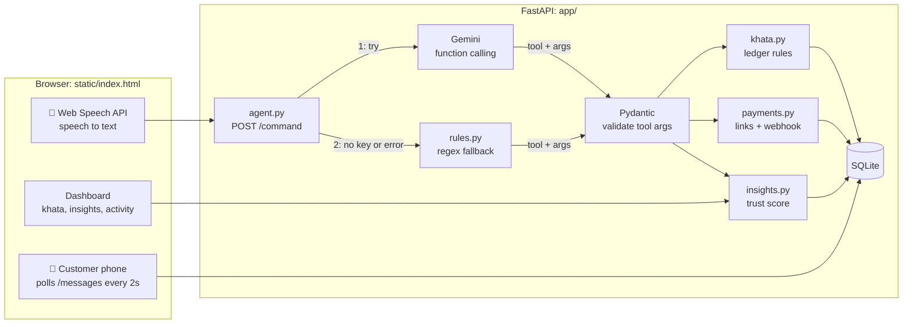
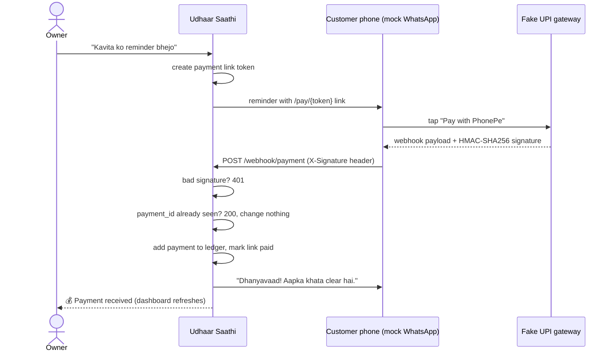

# Udhaar Saathi

**A voice-first AI assistant for the udhaar (credit) khata of an Indian kirana store.**

The shop owner just speaks, in Hindi, Marathi or English:

> 🎤 *"Ramesh ko 500 udhaar diya"*
> 🔊 *"Ramesh Patil ko ₹500 udhaar likh diya. Kul baaki ₹500."*

An AI agent updates the khata, sends the customer a WhatsApp reminder with a UPI payment
link, and closes the entry automatically when the customer pays. A dashboard shows a
trust score for every customer and simple business insights.

<!-- Screenshot placeholder: add docs/screenshots/dashboard.png -->


> ⚠️ **Portfolio project.** WhatsApp and UPI payments are **simulated**: no real messages
> are sent and no real money moves. See [What's mocked and why](#whats-mocked-and-why).

---

## The problem

Most neighbourhood kirana stores run on trust: regular customers take goods now and pay
later. That credit is usually tracked in a paper *bahi-khata*, which causes everyday problems:

- **Writing it down is slow** while customers are waiting at the counter.
- **Asking for money is awkward**, so reminders get delayed and dues pile up.
- **There's no overview**: who owes the most, who is slipping, which days are busiest.

Udhaar Saathi lets the owner manage the khata by voice, in the language they already speak,
and handles the uncomfortable part (reminders and collection) politely and automatically.

## Features

| | |
|---|---|
| 🎤 **Voice commands** | Hindi, Marathi or English via the browser's Web Speech API; replies are spoken back in short Hinglish |
| 🤖 **AI agent with 7 tools** | `add_udhaar`, `record_payment`, `get_balance`, `list_pending`, `send_reminder`, `remind_all`, `business_summary` |
| 🧠 **Two brains** | Google Gemini function calling, with a regex Hinglish/Marathi fallback that works offline with no API key |
| 🔎 **Fuzzy names** | "Ramesh ji", "ramsh" and "Patil" all find *Ramesh Patil*; "Rajesh" is **not** silently matched, and two Rameshes trigger a "which one?" |
| 💬 **Smart reminders** | Polite by default, firmer after 15 days overdue, always with a payment link |
| 💸 **Auto-closing khata** | A signed payment webhook records the payment, closes the link and thanks the customer |
| 📊 **Trust score (0–100)** | Based on repayment speed, current overdue days and reminders needed ([formula](app/insights.py)) |
| 📈 **Insights** | Week-over-week sales, 30-day chart, stuck udhaar, regulars who stopped coming, peak day/hour |
| 📱 **Customer phone panel** | A simulated WhatsApp screen showing every message the shop sends |

## Architecture



**The LLM only chooses; our code decides.** Gemini picks a tool and its arguments. Those
arguments are validated by the same Pydantic model that generated the tool's schema, then
executed by our own code, which enforces the business rules again. Replies are built from
templates using real database values, so a spoken balance can never be made up by the model.

### Payment flow



### Key design decisions

- **Balance is never stored.** It is always `SUM(udhaar) - SUM(payments)` from an
  append-only ledger, so it can't drift out of sync with the history.
- **Money is stored as integer rupees**, avoiding floating-point rounding errors.
- **Defence in depth for amounts:** Pydantic at the API, checks in `khata.py`, and
  `CHECK (amount > 0)` in the database.
- **Asking beats guessing.** Wrongly assigning udhaar to the wrong person is worse than
  asking again, so ambiguous names return a question, not a guess.
- **Webhooks are authenticated and idempotent.** The signature is checked on the raw
  bytes with a constant-time comparison; duplicate `payment_id`s are ignored. A test
  fires two identical webhooks at the same instant and checks only one is credited.
- **FIFO settlement:** payments clear the oldest udhaar first, which gives "days
  pending" and "average days to repay" for the trust score.
- **No secret in the browser:** the fake gateway signs on the server; the page only
  forwards the signed payload.

## What's mocked and why

| Real-world service | What this project does instead | Why |
|---|---|---|
| **WhatsApp Business API** | Messages are saved in a `messages` table and shown on an on-screen "customer phone" | The real API needs a verified business account and approved templates. The mock still shows exactly what the customer would receive |
| **UPI / Razorpay** | Our own `/pay/{token}` page and a fake gateway that signs a webhook with HMAC-SHA256 | Real payments need a registered merchant account. The webhook side (signature check, idempotency, ledger update) is written exactly as it would be for a real gateway |
| **Sales data** | `seed.py` generates 30 days of fake UPI sales with realistic hourly and weekly patterns | The insights need history to be meaningful in a demo |

All customer names and phone numbers are fictional (`+91980000000x`).

To go live, `payments.gateway_checkout()` would be replaced by the real gateway's checkout,
and the WhatsApp step in `payments._queue_reminder()` by an API call. The webhook handler
would stay the same.

## Tech stack

**Backend:** Python 3.10+, FastAPI, Pydantic v2, SQLite (plain `sqlite3`, no ORM)
**AI:** Google Gemini via the `google-genai` SDK (function calling), regex fallback
**Frontend:** a single `static/index.html`, vanilla JS, Web Speech API, `speechSynthesis`, canvas chart
**Tests:** pytest (180 tests)

## Project structure

```
app/
  main.py       FastAPI app: endpoints, error handling
  db.py         SQLite schema, connections, small migration
  models.py     Pydantic request/response models and agent tool schemas
  khata.py      Ledger rules: udhaar, payments, fuzzy names, FIFO
  agent.py      Gemini function calling, tool execution, Hinglish replies
  rules.py      Regex fallback parser (Hinglish / Marathi / English)
  payments.py   Payment links, reminders, fake gateway, signed webhook
  insights.py   Trust score and dashboard insights
  seed.py       Demo data: 8 customers, 30 days of sales
static/
  index.html    Dashboard (single page)
tests/          pytest suite
render.yaml     One-click deploy on Render
```

## Setup

Requires **Python 3.10+**. Voice input needs **Chrome or Edge**.

**Windows (PowerShell)**
```powershell
py -m venv .venv
.venv\Scripts\Activate.ps1
pip install -r requirements.txt
copy .env.example .env
python -m app.seed
uvicorn app.main:app --reload
```

**macOS / Linux**
```bash
python3 -m venv .venv
source .venv/bin/activate
pip install -r requirements.txt
cp .env.example .env
python -m app.seed
uvicorn app.main:app --reload
```

Open **http://127.0.0.1:8000**. API docs are at http://127.0.0.1:8000/docs.

> The browser only allows microphone access on `localhost` or HTTPS. Opening the app from
> a phone through your computer's LAN IP will load, but voice input won't work there.

### Environment variables

| Variable | Required | Purpose |
|---|---|---|
| `GEMINI_API_KEY` | No | Enables the Gemini brain. Without it, the rules parser handles everything |
| `GEMINI_MODEL` | No | Defaults to `gemini-flash-latest` |
| `WEBHOOK_SECRET` | Recommended | HMAC key for webhooks. If unset, a random one is generated per run |
| `SHOP_NAME` | No | Shown in reminders and on the payment page |
| `PUBLIC_BASE_URL` | No | Base URL for payment links (default `http://127.0.0.1:8000`) |
| `DB_PATH` | No | SQLite file location (default `udhaar.db`) |

### Run the tests

```bash
pytest -v
```

Tests use a fresh temporary database each time and never call the real Gemini API.
Some highlights:

| What | Where |
|---|---|
| Rules parser: 31 Hindi / Marathi / English phrasings | `tests/test_rules.py` |
| Bad, missing or tampered HMAC signature gets 401 | `tests/test_payments.py` |
| Duplicate webhook (sequential and simultaneous) credits once | `tests/test_payments.py` |
| Balance = sum of ledger, overpayment rejected | `tests/test_db.py`, `tests/test_khata.py` |
| Invalid LLM output (negative amount, invented tool) is refused safely | `tests/test_agent.py` |
| Trust score formula, caps and clamping | `tests/test_insights.py` |

## Try these commands

| Say or type | What happens |
|---|---|
| `Ramesh ko 500 udhaar diya` | Adds ₹500 to Ramesh's khata |
| `Kavita ne 1000 diye` | Records a ₹1000 payment |
| `Suresh ka kitna baaki hai?` | Speaks Suresh's balance and days pending |
| `Ganesh ko reminder bhejo` | Sends a (firm, he's 22 days late) reminder with a payment link |
| `sabko reminder bhejo` | Reminds everyone who owes money |
| `aaj kitna aaya?` | Today's UPI sales and udhaar summary |
| `kaun kaun baaki hai` | Lists who owes the most |

Then open a payment link from the customer phone, pay, and watch the khata update itself.

## API

| Method | Path | Purpose |
|---|---|---|
| `POST` | `/command` | `{text, lang}` to `{reply, tool_called, args, brain}` |
| `POST` | `/udhaar`, `/payment` | Add an entry directly |
| `GET` | `/khata` | Pending customers by balance, with days pending and trust score |
| `GET` | `/customer/{id}` | One customer with full ledger history |
| `POST` | `/customer/{id}/remind` | Send a reminder with a payment link |
| `GET` | `/summary`, `/insights`, `/activity` | Dashboard data |
| `GET` | `/messages` | The simulated WhatsApp inbox |
| `GET` | `/pay/{token}` | Simulated UPI payment page |
| `POST` | `/webhook/payment` | Signed, idempotent payment webhook |

## Deploy on Render

1. Push this repo to GitHub.
2. In Render: **New → Blueprint**, then pick the repo. `render.yaml` sets everything up.
3. Optionally paste a `GEMINI_API_KEY` when asked. `WEBHOOK_SECRET` is generated for you.

On the free plan the SQLite file is **reset on every restart**, and the app re-seeds demo
data on start. That's fine for a demo; real use would need a persistent disk or Postgres.
Render serves the app over HTTPS, so voice input also works from a phone there.

## Screenshots

<!-- Placeholders: save screenshots into docs/screenshots/ with these names. -->

| Dashboard | Insights |
|---|---|
|  |  |

| Payment page | Mobile |
|---|---|
|  |  |

## Limitations and next steps

- **Devanagari and number words** ("रमेश", "paanch sau") need Gemini; the offline rules
  only understand romanized text with digits.
- **"sabko reminder bhejo" lowers everyone's trust score**, even customers who weren't late.
  A fairer version would only count reminders sent after the grace period.
- **SQLite** is right for one shop on one machine; multiple shops would need Postgres
  and a `shop_id` on every table.
- **No login.** Anyone who can open the dashboard can change the khata.
- Real WhatsApp and UPI integrations (see [What's mocked](#whats-mocked-and-why)).
